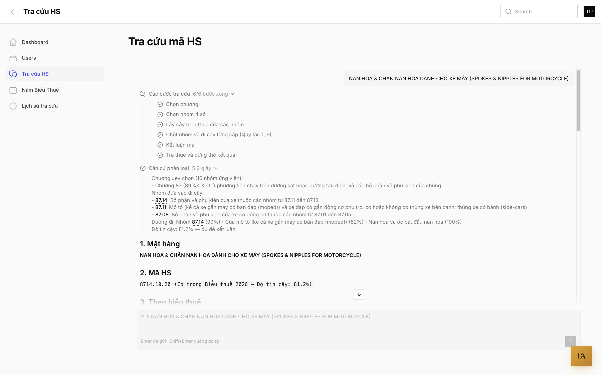
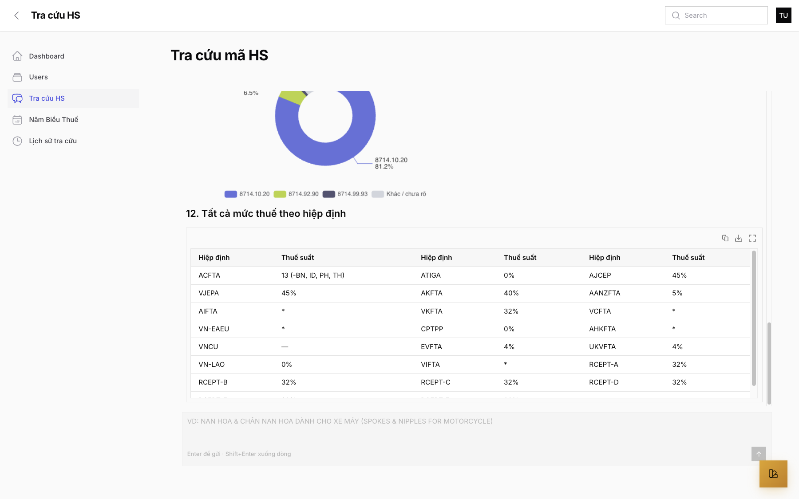
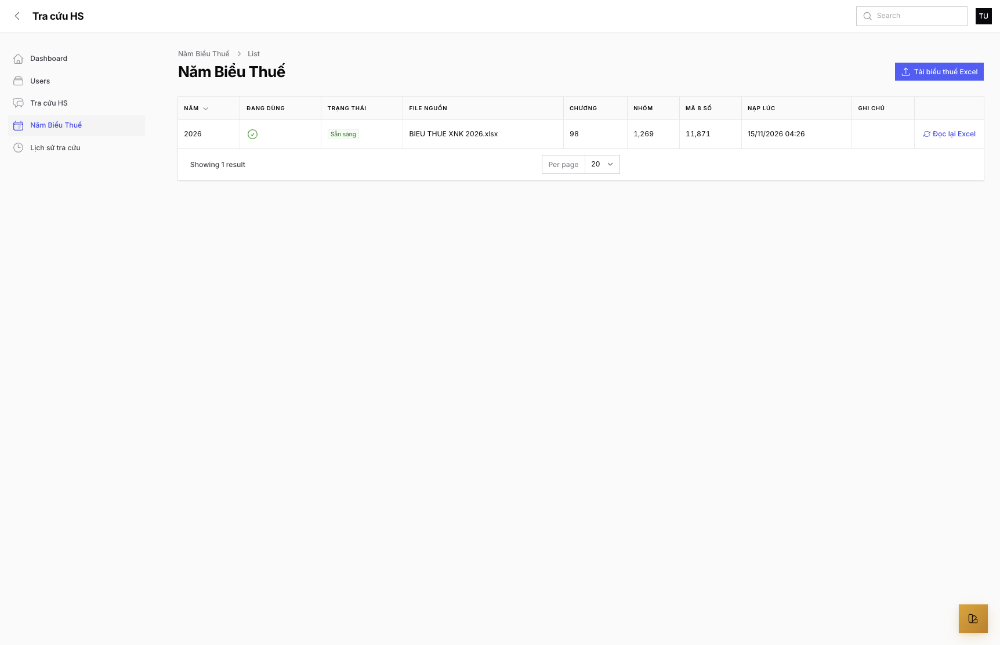
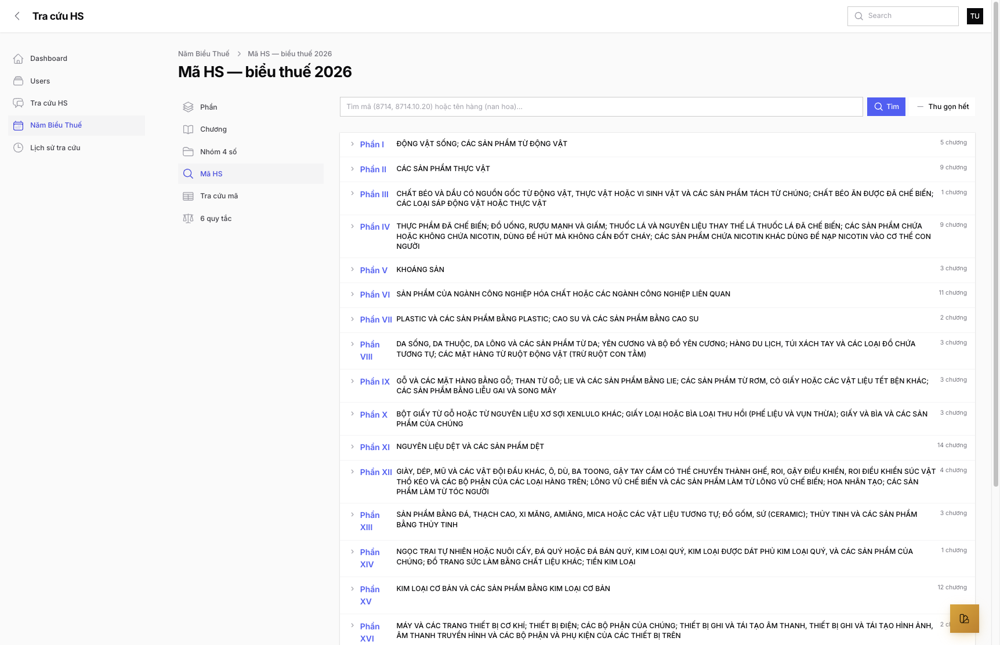
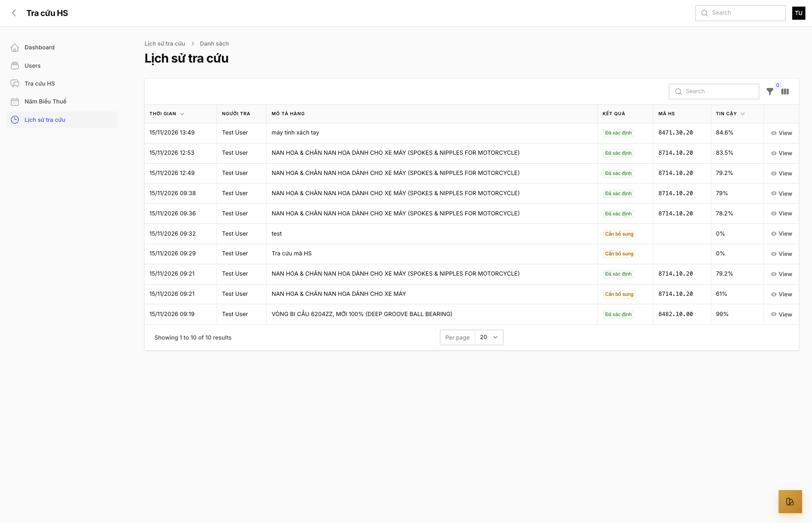

# Tra cứu mã HS — Biểu thuế XNK Việt Nam

Hệ thống tra cứu mã HS 8 số và thuế suất xuất nhập khẩu dựa trên **Laravel 13 + Filament 5** và **Laravel AI SDK**.  
Triết lý cốt lõi: **đã trả mã thì mã phải đúng** — nếu mô tả hàng hóa chưa đủ căn cứ phân loại, hệ thống sẽ chủ động hỏi lại đúng tiêu chí còn thiếu thay vì đoán mò.

---

## Tính năng nổi bật

- **Tra cứu mã HS thông minh theo Quy tắc 1 & Quy tắc 6**: đi từng bước từ Phần → Chương → Nhóm 4 số → Nhánh cây → Mã HS 8 số, hiển thị rõ căn cứ pháp lý, lưu ý rủi ro và gợi ý mô tả khai báo hải quan.
- **Trực quan hóa độ tin cậy & biểu thuế FTA**: tự động vẽ biểu đồ so sánh xác suất giữa các mã ứng viên và tra cứu đầy đủ thuế suất theo tất cả hiệp định (MFN, ACFTA, ATIGA, VJEPA, CPTPP, EVFTA, UKVFTA, RCEPT…).
- **Quản lý biểu thuế theo năm bằng Excel**: tải file biểu thuế `.xlsx` trực tiếp trên giao diện Admin, hệ thống tự động phân tích qua pipeline Python (`uv`), dựng cây phân cấp và cập nhật CSDL.
- **Duyệt cây biểu thuế trực quan**: tìm kiếm tức thì theo mã HS hoặc tên hàng hóa trên toàn bộ 98 Chương, 1.269 Nhóm và 11.871 mã 8 số.
- **Lưu vết lịch sử tra cứu**: theo dõi toàn bộ phiên tra cứu, trạng thái (`Đã xác định` / `Cần bổ sung`), mã HS và độ tin cậy để kiểm tra và đối chiếu.

---

## Giao diện sản phẩm

### 1. Khung chat Tra cứu mã HS (`/admin/tra-cuu`)
Nhập mô tả hàng hóa (ví dụ: *"NAN HOA & CHÂN NAN HOA DÀNH CHO XE MÁY (SPOKES & NIPPLES FOR MOTORCYCLE)"*), hệ thống tự động đi qua 6 bước phân loại, giải trình căn cứ và kết luận mã HS `8714.10.20` (độ tin cậy 81.2%):



Kèm biểu đồ so sánh xác suất giữa các mã ứng viên và bảng tổng hợp thuế suất theo từng hiệp định thương mại tự do:



### 2. Quản lý Năm Biểu Thuế (`/admin/tariff-years`)
Theo dõi trạng thái dữ liệu biểu thuế theo từng năm, tải lên file Excel mới hoặc kích hoạt đọc lại biểu thuế trực tiếp từ giao diện quản trị.



### 3. Cây Biểu Thuế & Danh mục Mã HS (`/admin/tariff-years/1/ma-hs`)
Duyệt cây phân cấp Phần → Chương → Nhóm 4 số → Mã HS, tìm kiếm nhanh theo mã hoặc mô tả hàng hóa và tra cứu 6 quy tắc phân loại.



### 4. Lịch sử tra cứu (`/admin/lich-su-tra-cuu`)
Tổng hợp toàn bộ các lượt tra cứu theo thời gian thực cùng kết quả phân loại và mức độ tin cậy.



---

## Chạy nhanh

```bash
composer run dev
```

Truy cập giao diện quản trị tại `http://localhost:8000/admin` (khung chat tại `/admin/tra-cuu`).

---

## Tài liệu liên quan

- [`docs/VAN_HANH.md`](docs/VAN_HANH.md) — Kiến trúc chi tiết, cấu trúc thư mục, nạp biểu thuế qua CLI, API và kiểm thử / benchmark.
- [`docs/QUY_TAC_PHAN_LOAI.md`](docs/QUY_TAC_PHAN_LOAI.md) — Quy tắc phân loại, ngưỡng tin cậy và lý do thiết kế.
- [`scripts/README.md`](scripts/README.md) — Pipeline Python (`uv` + `pytest`) đọc file Excel biểu thuế.
